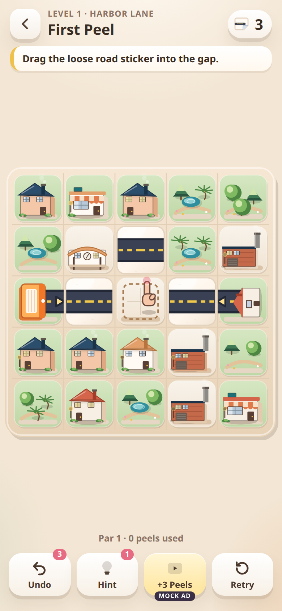

# Peel Streets

**Play:** https://ganeshbhandarkar-oss.github.io/peel-streets/

A hybrid-casual mobile puzzle prototype that runs in the browser. The city is a grid of **sticker tiles**: roads, tram rails and water pipes. You **peel** a sticker off (its corner curls up under your finger), **rotate or flip** it, and **snap** it onto an empty lot. When every garage, tram depot and water tower connects to its matching house, tram stop or fountain, cars, trams and water run along the new route and a building in the district is restored.

All art is original and drawn in code (Canvas 2D and inline SVG): an "afternoon diorama" of chunky buildings, layered trees and die-cut paper stickers. See DESIGN.md. Every sound is synthesised with WebAudio. There are no image, audio or font files, and no third-party assets or characters. Ads are **mocked**.



## How to play

| Action | Touch / mouse | Keyboard |
|---|---|---|
| Peel a sticker | Press and drag it: the corner curls, then the sticker lifts and follows you. Or just tap it. | |
| Rotate the held sticker | **Rotate** button (or right-click) | `R` |
| Flip (mirror) the held sticker | **Flip** button | `F` |
| Snap it down | Release over, or tap, a **glowing** empty lot (or its own tile) | |
| Put it back for free | **Put back** | `Esc` |
| Undo / Hint | Bottom bar | `Z` / `H` |

- **One peel = one move**, and that move includes any rotating or flipping. Dropping a sticker back unchanged is free.
- You run out of peels and the street **jams**: you can retry, undo, or take a mock "watch ad for +3 peels" offer.
- **Stars:** 3★ at par (the solver's optimum), 2★ at par+1, 1★ for any solve. The peel budget is par+2.
- **Sticker types:** normal stickers can rotate and flip. **Stiff** stickers (hatched amber frame) only flip. **Pinned** stickers (red pin) can't be peeled. **Litter** (pink) has no path and hides what's under it. **Bridge** stickers carry two path types. **Rubble** under a sticker means that lot can never take a sticker.
- **Hidden stacks:** you only see the top sticker. The coloured edges peeking out underneath hint at what's below (grey = road, brown = rail, blue = pipe, pink = litter, dark grey = rubble). Peeling shows it.

## Run / build / test

```bash
npm install
npm run dev          # http://localhost:5173/peel-streets/
npm run build        # type-check + production build into dist/
npm run preview      # serve dist at http://localhost:4173/peel-streets/
npm test             # vitest unit tests (engine, solver, levels, session, progress)
npm run validate     # solver proves every level solvable and checks par/budget
npm run e2e          # browser smoke test against preview (plays all 24 levels + input/ads/hints)
npm run screenshots  # regenerate docs/screenshots at 390x844 (needs preview running)
```

The e2e and screenshot scripts use `playwright-core` with a system Chrome (`/usr/bin/google-chrome`; override with `CHROME_PATH`).

**QA hooks:** `?level=N` opens a level directly. `?unlock=1` (or Settings → *QA: unlock all levels*) opens every level. In DevTools, `peelDebug.play(n)`, `peelDebug.step()`, `peelDebug.solve()` and `peelDebug.state()` are available, and analytics-style events (`level_start`, `level_complete`, `level_fail`, `hint_used`, `undo`, `ad_shown_mock`, `ad_rewarded_mock`) are pushed to `window.__peelEvents`.

**Deploy:** `.github/workflows/deploy.yml` runs tests, runs the validator, builds, and publishes `dist/` to GitHub Pages at https://ganeshbhandarkar-oss.github.io/peel-streets/. The Vite `base` is `/peel-streets/`, so the repo should be named `peel-streets`.

## Project structure

```
src/
  engine/       pure game logic, no DOM
    types.ts      directions bitmask, stickers, cells, level schema
    pieces.ts     shapes, rotate/flip, orientations, segment codes
    grid.ts       level parser, peel/place rules, connectivity (BFS), win check
    solver.ts     optimal A* solver over peel moves (+ lower-bound heuristic)
    hint.worker.ts  runs the solver off the main thread for hints
    game.ts       GameSession: budget, undo, jam, mock +3 peels, stars
  levels/
    levels.json   24 hand-made levels (data)
    solutions.json  optimal solutions written by the validator (used for hints / QA autoplay)
    index.ts      districts + level lookup
  render/
    palette.ts    diorama palette and the three district themes
    art.ts        procedural tile art: roads, rails, pipes, stickers, buildings, trees, endpoints
    board.ts      canvas renderer: curl/peel, lift, snap bounce, particles, shake, vehicles, hints
  input/pointer.ts  touch + mouse state machine (press-curl-lift-drag-snap, tap flow)
  audio/sfx.ts    WebAudio synth SFX + navigator.vibrate haptics
  meta/
    progress.ts   localStorage progress, unlocks, stars
    map.ts        district skyline SVG (buildings restore as levels are solved)
    analytics.ts  event stub
  ui/             DOM screens: map, HUD, modals (win, jam offer, mock ad, settings, level select)
scripts/
  validate-levels.ts  solver/validator CLI
  e2e-smoke.mjs, screenshots.mjs
tests/            vitest suites
docs/screenshots/ 390x844 captures
docs/screenshots/before-after/ pairs from the flat-pastel pass and the diorama pass
```

## Adding a level

Add an object to `src/levels/levels.json`:

```json
{"id": 25, "name": "My Street", "district": 2, "par": 0, "moves": 0, "tip": "optional",
 "rows": [
   "S:r:E  rI0    .      D:r:W",
   "#      rL1/j  #      #"
 ]}
```

Cell tokens are separated by spaces. Each row must have the same number of tokens.

| Token | Meaning |
|---|---|
| `.` | empty lot (stickers can be snapped here) |
| `#` | city block (decor, never playable) |
| `S:r:E` / `S:t:N` / `S:p:W` | source (r = road garage, t = tram depot, p = water tower) opening toward E/N/W/S. Add `:1` to pair several same-type routes. |
| `D:r:W` | destination of that type and pair, opening W |
| `rI1`, `tL2`, `pT0`, `rX`, `pD3` | a sticker: type (`r`/`t`/`p`), shape (`I` straight, `L` corner, `T`, `X` cross, `D` dead end), clockwise quarter-turns |
| `rI0+tI1` | multi-type bridge sticker |
| `j` | litter sticker (no path) |
| `x` | rubble layer (unpeelable, blocks the lot) |
| `a/b/c` | stack, **bottom first** (`rI0/j` = litter on top of a road) |
| suffix `!` / `@` | stiff (flip only) / pinned (can't peel) |

Then run `npm run validate -- --write`. It solves the level, writes the true `par` and the stored solution, and fails if the level is unsolvable or already solved. Set `moves` (the peel budget) to `par + 2` (the convention used here), then run `npm test`. `--verbose` prints the solution and `--only=25` checks just one level.

## Design notes

- **Solver:** a state is where every layer sits plus a "has been peeled" bit for each sticker. A sticker that has been peeled can take any of its legal orientations, so orientation is solved lazily: a small backtracking path search picks orientations at win-check time. This removes about 4^k states compared with a naive search. On top of that, A* with an admissible lower bound counts the "cells that still need fixing" on the cheapest route, using the fact that one peel can fix at most one placed cell plus one revealed cell. Every solution is replayed on the real board, and the e2e test replays them through the real UI.
- **Difficulty curve (par):** Harbor Lane 1·1·2·3·2·2·3·4 → Old Market 2·3·4·3·3·3·5·6 → Skyline Park 2·4·4·5·5·6·6·7. Each district restarts low as it introduces a new mechanic (rails, then pipes with hidden stacks and rubble), then ramps up. Mechanics come in this order: move (1), rotate (2–4), litter (5), flip (6–7), crossings (8), second path type (9–10), pins + stacks (11), T as corner (12), bridges (13), stiff + type mix (14–16), pipes + hidden stacks (17–18), rubble trap (19), three types (20–24).
- **Juice:** corner curl with a gradient back side and cast shadow, a lift with a drop shadow and bob, a landing tween plus a spring bounce on snap, dust puffs, confetti, a decaying screen shake, `navigator.vibrate` haptics, and synthesised peel/snap/rotate/flip/solve/jam sounds.

## Next steps

- Playtest the curve with real players. Track per-level fail rate, peels used vs par, and hint use.
- More mechanics for later districts: one-way stickers, timed traffic, stickers that must be used, and "double peel" stacks that move together.
- A level editor that uses the solver to auto-tune `par` and `moves`, plus a generator for daily puzzles.
- A real ads/analytics SDK behind the existing `track()` and `mockAd()` seams, remote config for budgets, and a store build via Capacitor.
- Accessibility: colour-blind patterns for the path types and a reduced-motion setting.
